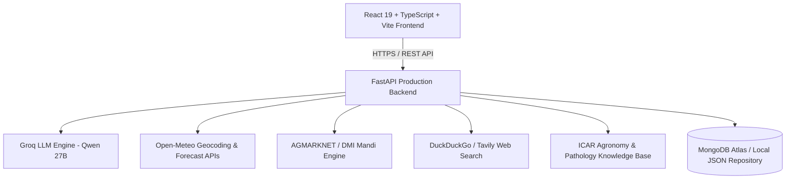

# 🌾 AgriVision AI — Smart Agriculture Monitoring & Farmer Assistance Platform

[](https://fastapi.tiangolo.com/)
[](https://react.dev/)
[](https://www.typescriptlang.org/)
[](https://www.python.org/)
[](https://agroai-6be2.onrender.com)
[](https://vercel.com/)
[](LICENSE)

> **AgriVision AI** is a production-grade, multimodal, multilingual agricultural intelligence platform designed to empower farmers, agronomists, and agricultural stakeholders across India. It integrates computer vision leaf pathology, real-time APMC Mandi pricing, live agromet weather advisories, interactive phenology crop calendars, government scheme eligibility checks, and a conversational ChatGPT/Groq-powered Krishi AI Assistant.

---

## 🚀 Live Deployments

- **Backend API (Render):** [https://agroai-6be2.onrender.com](https://agroai-6be2.onrender.com)
- **Interactive API Documentation:** [https://agroai-6be2.onrender.com/docs](https://agroai-6be2.onrender.com/docs)
- **Alternative ReDoc Docs:** [https://agroai-6be2.onrender.com/redoc](https://agroai-6be2.onrender.com/redoc)
- **GitHub Repository:** [https://github.com/princekumarjha83-oss/agroai](https://github.com/princekumarjha83-oss/agroai)

---

## 🌟 Key Modules & Capabilities

### 1. 🤖 Conversational Krishi AI Assistant (`/ai-assistant`)
An advanced multimodal, multilingual conversational AI assistant built on top of high-performance Groq LLMs (`qwen/qwen3.8-27b`) with real-time tool orchestration:
- **General-Purpose & Domain Versatile:** Answers agricultural queries with scientific precision (ICAR/IMD packages of practices) and answers non-agricultural questions (math, general science, letters, translations) directly without forcing agricultural metaphors.
- **Universal Weather Geocoding:** Auto-extracts target cities or districts worldwide using Open-Meteo geocoding. Returns current observations (°C), humidity, wind, and agromet pesticide spray advisories (e.g. rain hazard warnings).
- **Live Mandi Intelligence:** Retrieves official AGMARKNET arrivals, displays modal/min/max rates in both **₹/quintal** and converted **₹/kg** (`Modal Price ÷ 100`), states reporting dates, and compares with official CCEA/CACP MSP benchmarks.
- **Real-Time Web Search:** Uses DuckDuckGo HTML scraping, Tavily, and Brave to retrieve current market and news data, citing clickable sources `[Title](URL)`.
- **Multimodal Document Q&A:** Upload PDF, TXT, DOCX, or CSV files (e.g., Soil Health Cards, laboratory tests) to extract tables, summarize findings, and answer specific questions.
- **Multimodal Visual Leaf Diagnosis:** Upload leaf photos (`.jpg`, `.png`, `.webp`) for automated symptom analysis, pathogen identification, confidence scores, and organic/chemical treatments.
- **Multilingual Support (12+ Languages):** Full support for English, Hindi (हिन्दी), Kannada (ಕನ್ನಡ), Tamil (தமிழ்), Telugu (తెలుగు), Malayalam (മലയാളം), Marathi (मराठी), Bengali (বাংলা), Gujarati (ગુજરાતી), Punjabi (ਪੰਜਾਬੀ), Urdu (اردو), and Hinglish with authentic native-script output.
- **Full Voice Flow:** Integrated Speech-to-Text (`webkitSpeechRecognition`) and Text-to-Speech audio playback with Listen/Stop toggles.

### 2. 🔬 Crop Pathology & Disease Diagnosis Lab (`/crop-health`)
- Real-time diagnostic engine for foliar crop diseases across tomatoes, wheat, rice, mustard, cotton, potatoes, and more.
- Differentiates diseased vs. healthy tissue, checks for motion blur, and rejects non-plant images.
- Recommends both biological/organic controls (e.g. Neem oil, *Trichoderma*) and certified chemical interventions with safe Pre-Harvest Intervals (PHI).

### 3. 📈 MandiAI Price Intelligence (`/mandi`)
- Direct integration with **AGMARKNET** and the Government of India Open Data Platform.
- Live price tracking across major state APMC yards (Madhya Pradesh, Rajasthan, Karnataka, Maharashtra, Punjab, etc.).
- Commodity arrival volume tracking, 7-day price volatility trends, and statutory Minimum Support Price (MSP) floor tracking.

### 4. 🌦️ Agromet Weather Forecast & Spray Window (`/weather`)
- Powered by high-resolution Open-Meteo European Centre (ECMWF) forecast models.
- 7-day hourly forecasts for temperature, rainfall probability, relative humidity, and wind vector.
- **Agricultural Spray Condition Index:** Real-time computation evaluating wind velocity, rain probability, and temperature to determine safe foliar pesticide application windows.

### 5. 📅 Crop Phenology & Activity Calendar (`/crop-calendar`)
- Growing Degree Days (GDD) and phenological staging (Germination, CRI, Tillering, Booting, Flowering, Grain Filling, Maturity).
- Dynamic agronomic scheduling for wheat, mustard, tomatoes, and other regional crops.
- Personalized task checklist with completion tracking and offline local storage synchronization.

### 6. 🏛️ Government Schemes & Subsidies Portal (`/schemes`)
- Direct access to central and state farmer schemes: **PM-KISAN**, **Kisan Credit Card (KCC)**, **Pradhan Mantri Fasal Bima Yojana (PMFBY)**, Solar Pump Subsidies, and Soil Health Card missions.
- Eligibility requirements, financial assistance amounts, application steps, and official ministry portal links.

### 7. 📺 Video Academy (`/video-academy`)
- Integrated extension video library featuring Hindi and regional agricultural tutorials.
- Bookmark favorite lessons on seed treatment, drip irrigation, pest scouting, and post-harvest management.

---

## 🛠️ Architecture & Technology Stack



### Frontend
- **Framework:** React 19, TypeScript, Vite
- **Styling:** Vanilla CSS design system with custom CSS variables (Forest Green, Agri Green, Cream Surface)
- **Icons:** Lucide React
- **Voice:** Web SpeechRecognition API + Web SpeechSynthesis

### Backend
- **Framework:** FastAPI (Python 3.10+)
- **ASGI Server:** Uvicorn / Gunicorn
- **AI / LLM:** Groq API (`qwen/qwen3.8-27b`)
- **Document Processing:** `pypdf`, `python-docx`, `pillow`
- **Database:** MongoDB Atlas via `motor` (async driver) with resilient `LocalRepository` fallback
- **Security:** PyJWT, Passlib (Bcrypt), Certifi (TLS CA verification), CORS middleware

---

## 📦 Project Structure

```text
agroai/
├── backend/                        # FastAPI Production Backend
│   ├── app/
│   │   ├── api/                    # Modular API Routers
│   │   │   ├── routes_assistant.py # Krishi AI chat, upload & voice routes
│   │   │   ├── routes_auth.py      # JWT authentication & user profile
│   │   │   ├── routes_calendar.py  # Phenology crop calendar routes
│   │   │   ├── routes_crop_health.py # Leaf pathology diagnosis
│   │   │   ├── routes_farms.py     # Farm plots management
│   │   │   ├── routes_mandi.py     # Mandi prices & AI market advisor
│   │   │   ├── routes_schemes.py   # Government schemes & eligibility
│   │   │   ├── routes_weather.py   # Weather forecasts & spray conditions
│   │   │   └── routes_videos.py    # Agricultural video academy
│   │   ├── core/                   # Core configuration, security & DB client
│   │   │   ├── config.py           # Pydantic environment settings
│   │   │   ├── database.py         # MongoDB Atlas client + Local fallback
│   │   │   └── security.py         # JWT tokens & password hashing
│   │   ├── models/                 # Pydantic schemas & response models
│   │   ├── services/               # Core business logic & tool integrations
│   │   │   ├── ai_assistant_service.py # Orchestrator for Krishi AI
│   │   │   ├── crop_health_service.py  # Computer vision pathology
│   │   │   ├── mandi_service.py        # AGMARKNET market service
│   │   │   ├── weather_service.py      # Open-Meteo forecast service
│   │   │   ├── web_search_service.py   # Live web search engine
│   │   │   └── document_parser_service.py # PDF/TXT/DOCX extraction
│   │   └── main.py                 # FastAPI application entrypoint
│   ├── tests/                      # Comprehensive automated test suites (43 tests)
│   ├── requirements.txt            # Python dependencies
│   └── runtime.txt                 # Python 3.10.11 version pin for Render
├── src/                            # React 19 Frontend
│   ├── components/                 # UI layout, Navbar & LanguageSelector
│   ├── pages/                      # Application route pages
│   │   ├── AIAssistantPage.tsx     # Upgraded Krishi AI Assistant UI
│   │   ├── CropHealthPage.tsx      # Leaf diagnosis lab
│   │   ├── MandiPricesPage.tsx     # APMC market intelligence
│   │   ├── WeatherForecastPage.tsx # Weather & spray window
│   │   ├── CropCalendarPage.tsx    # Crop phenology scheduler
│   │   ├── GovernmentSchemesPage.tsx # Schemes portal
│   │   └── VideoAcademyPage.tsx    # Video lessons
│   ├── services/
│   │   └── apiServices.ts          # Unified frontend API service layer
│   ├── types/                      # TypeScript interfaces & types
│   └── App.tsx                     # Main client router & navigation
├── vercel.json                     # Vercel SPA client-side routing config
├── render.yaml                     # Render Web Service Blueprint
├── .env.example                    # Environment variables template
├── package.json                    # Frontend dependencies
└── vite.config.ts                  # Vite build configuration
```

---

## ⚡ Quickstart Guide (Local Development)

### 1. Prerequisites
- **Node.js**: v18.0.0 or higher
- **Python**: v3.10 or higher
- **Git**

### 2. Clone the Repository
```bash
git clone https://github.com/princekumarjha83-oss/agroai.git
cd agroai
```

### 3. Backend Setup
```bash
cd backend

# Create and activate Python virtual environment
python -m venv venv
# On Windows:
.\venv\Scripts\activate
# On Linux / macOS:
source venv/bin/activate

# Install dependencies
pip install -r requirements.txt

# Configure Environment Variables
cp ../.env.example .env
# Edit .env and supply your GROQ_API_KEY (obtainable free at console.groq.com)

# Start FastAPI development server
uvicorn app.main:app --host 0.0.0.0 --port 8000 --reload
```
Backend will be live at `http://localhost:8000`. Test docs: `http://localhost:8000/docs`.

### 4. Frontend Setup
In a new terminal window:
```bash
cd agroai

# Install npm packages
npm install

# Start Vite development server
npm run dev
```
Frontend will be live at `http://localhost:5173`.

---

## 🧪 Running Automated Tests

The backend includes a comprehensive 43-test suite covering authentication, plant pathology computer vision, weather geocoding, mandi pricing, multimodal document parsing, and Groq assistant workflows.

```bash
cd backend
.\venv\Scripts\activate
pytest tests/ -v
```
Output:
```text
================= 43 passed, 2 warnings in 273.68s ==================
```

---

## 🌐 Production Deployment

### Backend Deployment (Render)
1. Push your code to GitHub.
2. Sign in to [Render.com](https://render.com) and create a **New Web Service** connected to your repository.
3. Set **Root Directory** to `backend`.
4. Set **Build Command** to `pip install -r requirements.txt`.
5. Set **Start Command** to `uvicorn app.main:app --host 0.0.0.0 --port $PORT`.
6. Add the following **Environment Variables**:
   - `PYTHON_VERSION`: `3.10.11`
   - `ENVIRONMENT`: `production`
   - `DEBUG`: `false`
   - `GROQ_API_KEY`: *Your Groq API key*
   - `GROQ_MODEL`: `qwen/qwen3.8-27b`
   - `JWT_SECRET`: *A secure random string*
   - `MONGODB_URI`: *Your MongoDB connection string*
   - `OPEN_METEO_BASE_URL`: `https://api.open-meteo.com/v1`
   - `GEOCODING_BASE_URL`: `https://geocoding-api.open-meteo.com/v1`
7. Click **Deploy Web Service**.

### Frontend Deployment (Vercel)
1. Sign in to [Vercel.com](https://vercel.com) and import the repository `princekumarjha83-oss/agroai`.
2. Click **Import single project** next to `app (Vite)`.
3. Framework Preset: **Vite** (auto-detected).
4. Add the following **Environment Variable**:
   - **Key:** `VITE_API_BASE_URL`
   - **Value:** `https://your-render-app-name.onrender.com/api`
5. Click **Deploy**.

---

## 🔒 Security & Privacy

- **Zero Secret Leakage:** `.env`, `.venv`, and sensitive credential files are strictly excluded via `.gitignore`.
- **Stateless AI Routing:** User documents and images are analyzed in-memory or in isolated upload directories with size limits (15 MB max).
- **TLS/SSL Certificate Verification:** Configured with `certifi` CA root bundles for reliable MongoDB Atlas and external API connections.

---

## 📄 License

This project is licensed under the MIT License — see the [LICENSE](LICENSE) file for details.

---

## 👨‍💻 Author & Contributions

Developed with ❤️ for Indian farmers and sustainable agriculture by **[Prince Kumar Jha](https://github.com/princekumarjha83-oss)**. Contributions, feature suggestions, and bug reports are warmly welcome!
